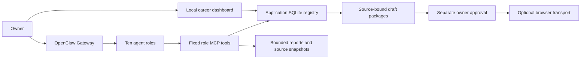

# Architecture

OpenClaw is an installed upstream dependency, not a vendored fork. Custom code
adds a role-specific MCP interface, application state and local interfaces.

Native OpenClaw state and application SQLite state have different owners.
The former stores agent/session runtime; the latter stores tasks, results,
evidence and workflow stages. Configuration is not execution evidence, and a
model response is not proof of a completed business action.

Roles: coordination, mail, backup reports, host security, career research,
web development, improvement review, web security, analytics and client research.
The native coordinator ID is `main`; the application role is `main-1`.

MCP validates tool inputs and role availability before dispatch. Application
workflows keep source hashes, profile versions, exact package digests, bounded
approvals and explicit unknown outcomes. External descriptions and forms are
untrusted data. Sending requires a separately configured and authorized path.

Ubuntu launchers manage Gateway and the read-only dashboard through user systemd
services. They are not a general autonomous campaign bootstrap. Template cron,
heartbeat, learning and campaigns are disabled; backup is paused.

The project still has file/SQLite boundaries, Windows-dependent legacy helpers
and some version-pinned adapters to OpenClaw internals. This edition documents
these limitations rather than claiming a complete portable platform.
